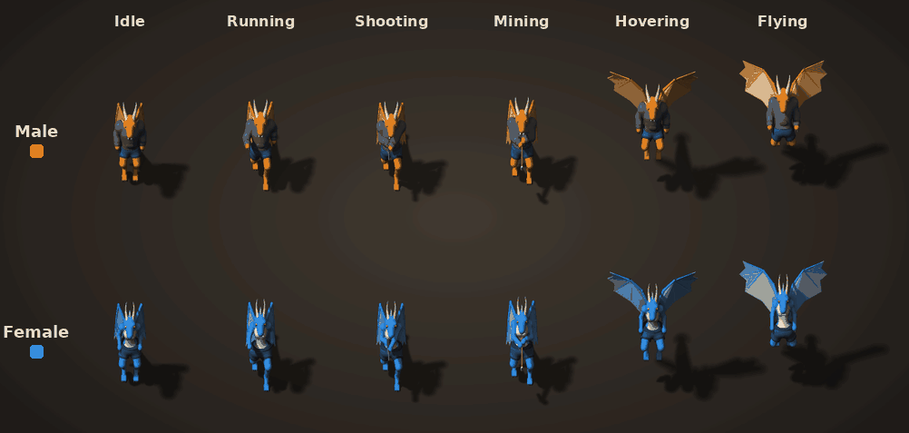

# Factorio Dragon Character Mod

A mod for Factorio 2.0 that turns your character into a dragon, with wings and a
tail, plus an in-game window to customize it.



## Features

- **Dragon character.** The engineer is replaced by an anthro dragon with wings,
  a tail, horns and a cream belly. It has every character animation: idle,
  running, shooting while running (18 aiming directions), mining with a pickaxe,
  and a corpse.
- **Customization window.** Open it with the dragon button in the shortcut bar,
  the dragon button in the top-left corner, **Ctrl + Shift + D**, or `/dragon`.
  - **Scale color:** 18 presets, RGB sliders or a hex code. The color is your
    player color (the same one `/color` sets), so your map marker matches.
  - **Body shape:** male or female.
  - **Outfits:** toggle a hoodie and shorts, separately or together.
  - A live camera preview shows your dragon while you change it.
- **Flying (Space Age).** With mech armor the dragon flies by flapping its wings
  instead of using the mech's thrusters.
- **Corpses match your look.** Body shape and outfits carry over to your corpse.
- **Multiplayer.** Every player picks their own look.

Body-shape and outfit changes apply instantly. If they can't apply right now
(you're in a vehicle, handcrafting, using remote view, your personal robots are
out, and so on), the window says so and the change applies automatically as soon
as it can.

## Installing

Copy the `dragon-character` folder into your Factorio `mods` folder, or build a
zip:

```sh
tools/build_mod.sh            # -> build/dragon-character_0.1.0.zip
```

The folder must be named `dragon-character` (or `dragon-character_<version>`).

## Removing the mod from a save

Body shapes and outfits other than the default (male, no outfits) are separate
character prototypes. If the mod is removed while a player or corpse uses one,
Factorio deletes that character or corpse when the save loads, **along with the
items it holds**. Before removing the mod:

1. Make sure every player is online, alive and not in a vehicle.
2. Run `/dragon-revert-all` (admin only). It switches everyone, and every dragon
   corpse, back to the vanilla prototypes and reports anything it couldn't
   convert.
3. Save, then disable the mod.

## Compatibility notes

- The vanilla `character` prototype becomes the default dragon. Other looks use
  `dragon-character-<body>-<outfit>` prototypes, copied from `character` in
  `data-final-fixes` so they inherit changes other mods make to it.
- Other mods that replace the character graphics will conflict with this one.
- If another mod temporarily swaps your character (a jetpack, for example), this
  mod leaves it alone and reapplies your look once you're back to a normal
  character.
- Remote interface `dragon-character`: `get_appearance(player_index)`,
  `set_appearance(player_index, {body=, hoodie=, shorts=})`,
  `is_dragon_character(name)` and `get_on_character_swapped_event()`. That
  event is raised whenever the mod replaces a player's character entity, with
  `old_character` and `new_character`.

## Development

### Repository layout

| Path | What it is |
| --- | --- |
| `dragon-character/` | The mod itself. |
| `dragon-character/prototypes/sprite-data.lua` | Generated sprite metadata: sizes and shifts of every sheet. |
| `tools/dragon_render/` | The procedural renderer that draws all the dragon sprites. |
| `docs/showcase.gif` | The animated README banner, built by `tools/dragon_render/showcase.py`. |
| `tools/build_mod.sh` | Packs the mod into a zip. |
| `tests/` | Headless Factorio test of the character swap logic. |

### Regenerating the sprites

The sprites are rendered from a procedural 3D model, a signed-distance-field
ray marcher in Python. Requires Python 3 with `numpy`, `pillow` and `numba`.

```sh
pip install numpy pillow numba
python3 -m tools.dragon_render.generate --force          # everything (about 45 min on 4 cores)
python3 -m tools.dragon_render.generate --only idle,run --force
python3 -m tools.dragon_render.generate --extras         # corpse, icons, thumbnail, swatches only
python3 -m tools.dragon_render.showcase                  # README banner (docs/showcase.gif)
```

The README banner is assembled from the finished sheets, so it only needs
`numpy` and `pillow` and takes a few seconds. Rebuild it after regenerating the
sprites.

The model (proportions, horns, wings, outfits) is in `model.py`, the poses for
each animation are in `anims.py`, and materials and colors are in `scene.py`.

Each animation is rendered into five layers, drawn in this order:

| Layer | Purpose |
| --- | --- |
| `base` | Everything that isn't tinted: belly, horns, claws, eyes, held tools. Dark under the scales. |
| `mask` | Greyscale shading of the scales, drawn with `apply_runtime_tint` so it takes the player color. |
| `shorts` | Only the visible parts of the shorts (anything in front of them, like the tail, is already cut out). |
| `hoodie` | Only the visible parts of the hoodie (anything in front of it, like the wings seen from behind, is cut out). |
| `shadow` | Ground shadow, drawn with `draw_as_shadow`. |

Sheets have one row per direction (north first, then clockwise) and one column
per frame. To swap in hand-drawn art, replace the PNGs under
`dragon-character/graphics/entity/dragon/` and update the matching
width/height/shift entries in `tools/dragon_render/sprite_meta.json`, then
regenerate `sprite-data.lua`, or edit it directly.

### Testing

`tests/run_headless.sh` loads the mod in a headless Factorio server, which
validates every prototype. It then runs `tests/dragon-character-test`, which
swaps a fully equipped character (power armor with an equipment grid, a full
inventory including the armor's bonus slots, guns, ammo, trash, filters,
logistic requests and bonuses) into a dragon variant and checks that nothing
was lost.

```sh
tests/run_headless.sh /path/to/factorio               # base game
tests/run_headless.sh /path/to/factorio --space-age   # with Space Age, Quality, Elevated Rails
```

The headless server is a free download from factorio.com. It can't connect a
player, so the customization window itself has to be checked in the real game.
