# In-game checks

Mods: avatar-bundle-test-server 1.0.0, avatar-characters 0.3.0, avatar-characters-screenshots 0.1.0, base 2.1.23, elevated-rails 2.1.23, quality 2.1.23, recycler 2.1.23, space-age 2.1.23

## idle-south

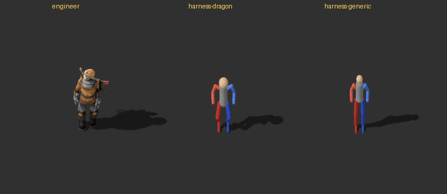 (2 frames, one every 10 ticks; [all frames](idle-south-strip.png))

- engineer: moved 0.15
- harness-dragon: moved 0.15
- harness-generic: moved 0.15

## run-east

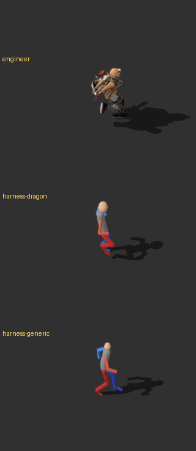 (31 frames, one every 2 ticks; [all frames](run-east-strip.png))

- engineer: moved 14.84
- harness-dragon: moved 14.84
- harness-generic: moved 14.84

## run-south

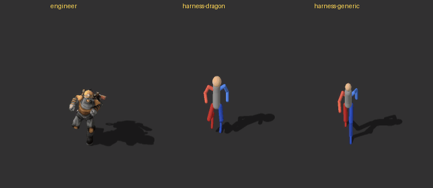 (26 frames, one every 2 ticks; [all frames](run-south-strip.png))

- engineer: moved 13.36
- harness-dragon: moved 13.36
- harness-generic: moved 13.36

## run-gun-east-aim-north

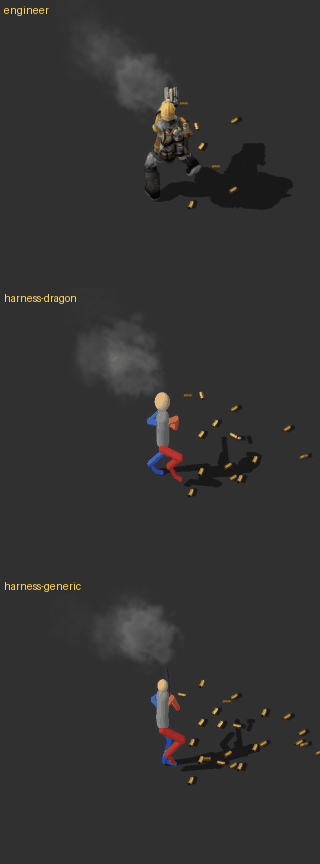 (31 frames, one every 2 ticks; [all frames](run-gun-east-aim-north-strip.png))

- engineer: moved 4.3, shots_fired 17
- harness-dragon: moved 4.3, shots_fired 17
- harness-generic: moved 4.3, shots_fired 17

## run-gun-west-aim-north

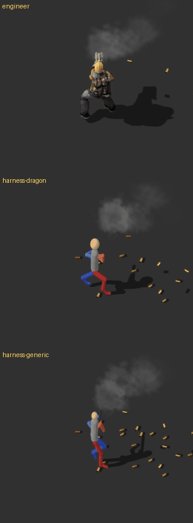 (31 frames, one every 2 ticks; [all frames](run-gun-west-aim-north-strip.png))

- engineer: moved 4.3, shots_fired 17
- harness-dragon: moved 4.3, shots_fired 17
- harness-generic: moved 4.3, shots_fired 17

## run-gun-east-aim-east

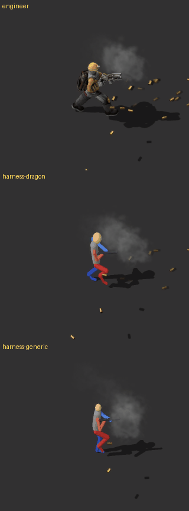 (31 frames, one every 2 ticks; [all frames](run-gun-east-aim-east-strip.png))

- engineer: moved 4.3, shots_fired 17
- harness-dragon: moved 4.3, shots_fired 17
- harness-generic: moved 4.3, shots_fired 17

## run-gun-east-aim-south

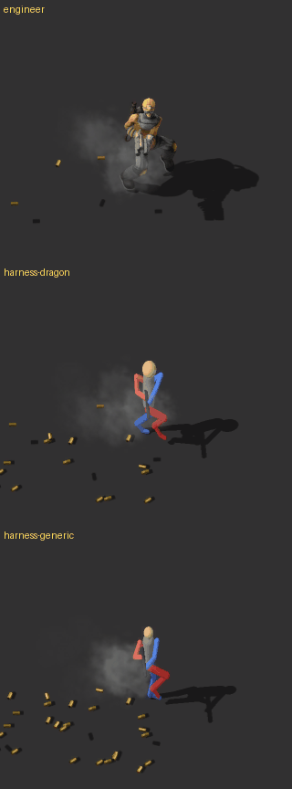 (31 frames, one every 2 ticks; [all frames](run-gun-east-aim-south-strip.png))

- engineer: moved 4.3, shots_fired 17
- harness-dragon: moved 4.3, shots_fired 17
- harness-generic: moved 4.3, shots_fired 17

## run-gun-north-aim-west

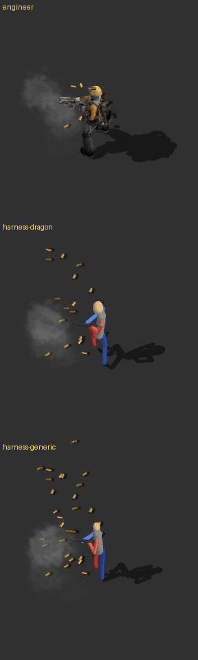 (31 frames, one every 2 ticks; [all frames](run-gun-north-aim-west-strip.png))

- engineer: moved 4.3, shots_fired 17
- harness-dragon: moved 4.3, shots_fired 17
- harness-generic: moved 4.3, shots_fired 17

## mine-east

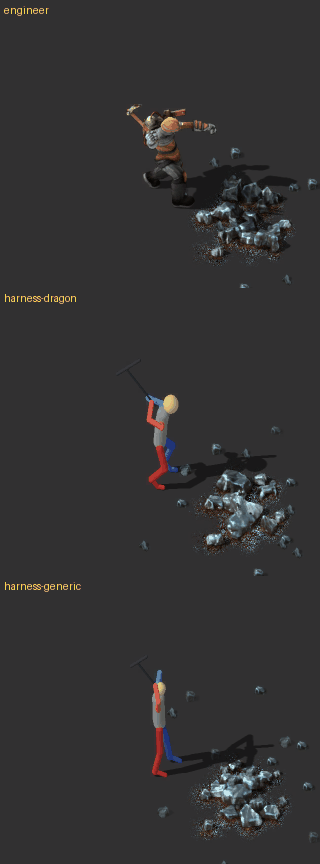 (31 frames, one every 2 ticks; [all frames](mine-east-strip.png))

- engineer: moved 0.15, ore_mined 1
- harness-dragon: moved 0.15, ore_mined 1
- harness-generic: moved 0.15, ore_mined 1

## fly-east

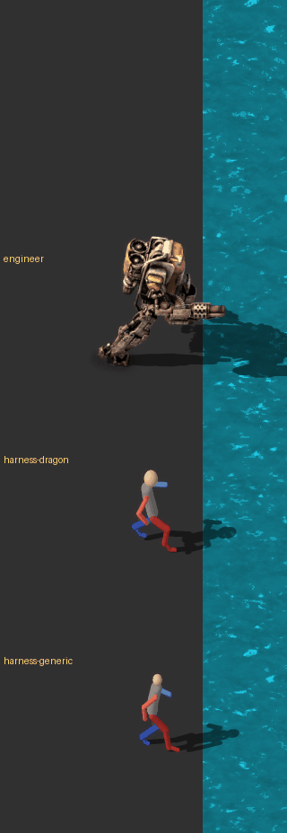 (57 frames, one every 3 ticks; [all frames](fly-east-strip.png))

- engineer: moved 19.26, flew True
- harness-dragon: moved 19.26, flew True
- harness-generic: moved 19.26, flew True

## fly-land-east

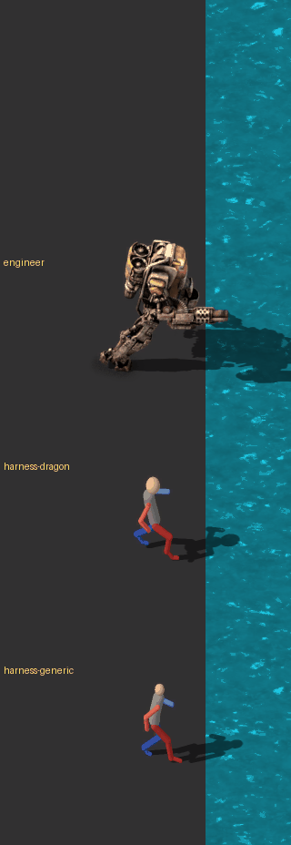 (57 frames, one every 3 ticks; [all frames](fly-land-east-strip.png))

- engineer: moved 28.13, flew True, landed True, landed_at_tick 102
- harness-dragon: moved 28.13, flew True, landed True, landed_at_tick 102
- harness-generic: moved 28.13, flew True, landed True, landed_at_tick 102

## fly-gun-east-aim-north

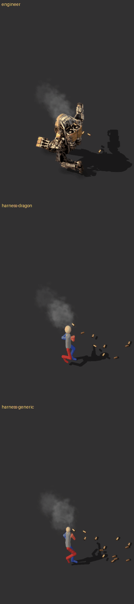 (57 frames, one every 3 ticks; [all frames](fly-gun-east-aim-north-strip.png))

- engineer: moved 5.68, shots_fired 32, flew True
- harness-dragon: moved 5.68, shots_fired 32, flew True
- harness-generic: moved 5.68, shots_fired 32, flew True

## fly-gun-east-aim-east

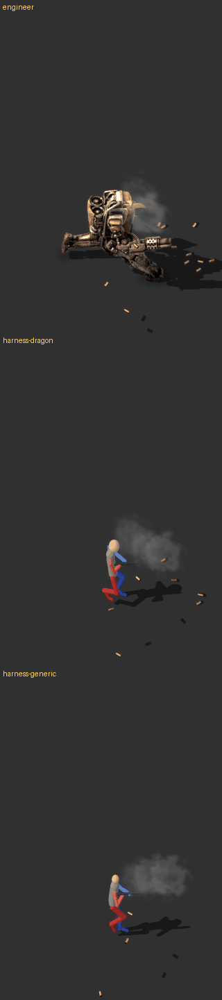 (57 frames, one every 3 ticks; [all frames](fly-gun-east-aim-east-strip.png))

- engineer: moved 5.68, shots_fired 32, flew True
- harness-dragon: moved 5.68, shots_fired 32, flew True
- harness-generic: moved 5.68, shots_fired 32, flew True

## corpse

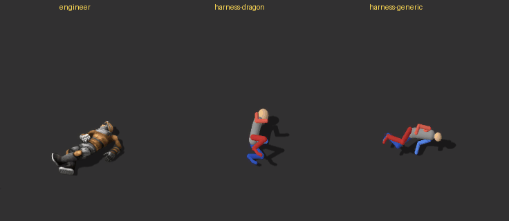 (1 frames, one every 10 ticks; [all frames](corpse-strip.png))

- engineer: corpse True
- harness-dragon: corpse True
- harness-generic: corpse True

## The avatar window

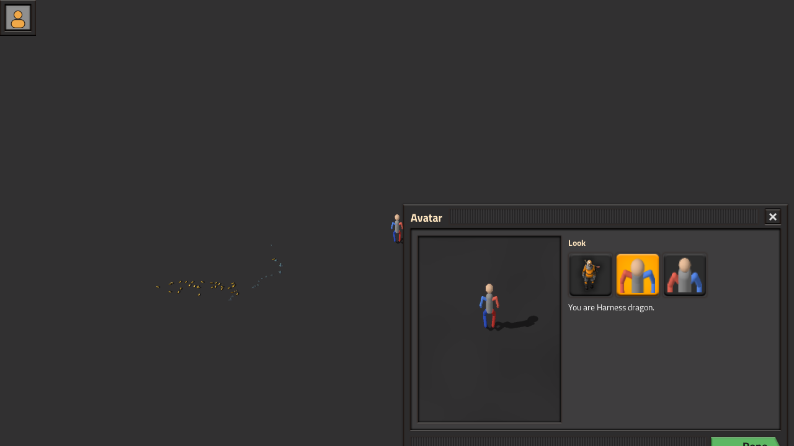

- character: avatar-pack-harness-dragon, pack: harness-dragon, status: applied, window_open: True

## Observations

### What this run covers, and what it doesn't

- **Draco is not in this run.** The laptop that ran it has no Unity editor and no Unity project; the only
  copy of the Draco project is an online-only OneDrive backup. So step 1 (`run_unity_spike.ps1 -Mode
  pack`) was not run, there is no `unity-spike\...\Draco\report.txt`, and nothing here compares colours
  or shading with Unity.
- **Stand-in for Draco:** the bundle "Test server" (`avatar-bundle-test-server_1.0.0.zip`) holds two
  pack-harness packs instead of Draco plus the harness:
  - `harness-generic` (`--rig generic`), as specified;
  - `harness-dragon` (`--rig dragon`).

  Both are flat-shaded stick figures drawn by the harness, not Unity renders, and they come from
  different pose sources:
  - `harness-generic` goes through the humanoid exporter (`HumanoidAnimations` on a measured rig),
    the same path a Unity export of Draco takes. **It is the real stand-in for Draco.**
  - `harness-dragon` uses `DragonPoseSource`, the archived Dragon Character's own poses and timing,
    drawn on a stick figure. It does not show what the humanoid exporter would do with Draco.
- **Setup:** Factorio was updated by Steam from 2.0.77 to **2.1.23** (Space Age on), and the .NET 8 SDK
  (8.0.426) was installed with winget. The checks ran on the first try. **No script or exporter fixes
  were needed.**
- Below, "dragon" means harness-dragon and "generic" means harness-generic. Frame n of each scene is at
  tick `from + every × (n − 1)`: 40 + 2(n − 1) for idle, run and gun on foot, 100 + 2(n − 1) for
  mine-east, and 20 + 3(n − 1) for the flight scenes. Distances are screenshot pixels, 64 per tile.

### Look: placement, size, edges (idle-south, run-east, run-south)

- Both figures stand on their spot, centred within 1 px horizontally. Their leg ends reach 13–14 px
  below the entity position, against 7 px for the engineer's boots, so they sit about 0.1 tile lower.
- They are a little shorter than the engineer: the head top is 81 px (dragon) and 85 px (generic) above
  the feet, against 97 px. The dragon has the bigger head and the shorter legs.
- Edges are clean on the dark floor and on water. There are no halos or fringes at 3× zoom.

### Shadows

- They point the same way as the engineer's: east and slightly up (centroid y −7 to −10 px, engineer
  −11 px). With the gun aimed west the sprite is mirrored but the shadow still falls east
  (run-gun-north-aim-west), so `shadow-flipped` works.
- **Length:** generic's shadow is as long as the engineer's (centroid +53 px at idle, against +52).
  Dragon's is about half as long (+27 px).
- **Start at the feet:** the engineer's shadow starts at the boots (0.1 px gap). Both figures' shadows
  start about 6–7 px above where their legs end, because the legs reach below the entity position (see
  above). It reads as attached at normal zoom.
- In run-south, dragon's shadow swings from +52 px to +6 px and back once per stride (frames 9 → 13 →
  17), as the long leg shadows open and close. The engineer's swings 9 px. It is smooth, not a flicker.

### Movement: leg pace

- **Dragon keeps the engineer's pace exactly:** both repeat every 32 ticks (16 screenshots; lag-16
  difference 0 in run-east and run-south). That is the old dragon's fixed timing
  (`distance_per_frame` 0.238).
- **Generic repeats every 38 ticks,** about 16% slower. That is intended by the humanoid exporter:
  its `distance_per_frame` is 0.2814, because the exporter scales the stride with leg length (unit
  test `RunTimingKeepsTheEngineersPace`). Its longer legs take longer steps at the same ground speed.
  Draco's pace will follow his own leg length the same way.
- Both run with real strides (knee up, back leg extended; run-east frames 1–15), comparable to the
  engineer's. In run-south both legs step toward the camera properly.

### Gun

- Everyone fires 17 shots in each on-foot gun scene and moves 4.3 tiles; the SMG slows its shooter to
  30%.
- **Aim east:** the gun is held level in both hands, pointing east, with the muzzle flash at its tip.
- **Aim south:** the gun points down toward the camera in front of the torso.
- **Aim west** (run-gun-north-aim-west): mirrored, the gun points west in the hands.
- **Aim north:** the gun is mostly hidden behind the body, as with the old dragon. Generic's barrel
  shows above its head.
- While running away from the aim (run-gun-west-aim-north), the legs keep a proper stride and the torso
  keeps facing north.

### Pickaxe and ore (mine-east)

- All three mine one ore and swing at the same rate.
- The figures' picks come down to the ground (frames 5–8, ticks 108–114), unlike the old Dragon
  Character's, which stopped at hip height. But they strike about half a tile ahead of the feet,
  roughly 0.4–0.5 tile short of the ore patch's near edge.
- The engineer's pick lands on that edge (frames 6–7). The ore sits 1.3–2 tiles east and slightly
  south of the feet (resources snap to the tile grid).

### Flight with mech armor (fly-east, fly-land-east)

- **Take-off** (fly-land-east): running (frames 2–3), standing at the shore (4, tick 29), crouch and
  rise (5–9). The shadow detaches and slides east as height grows.
- **Flying:** dragon flies with its knees folded under it; generic with its legs trailing diagonally
  back.
- **Landing** (new scene; everyone lands at tick 102): a reversed take-off. The figures descend upright
  with bent legs (frames 23–27), feet meet the ground line at frame 27, and they run on from frame 28.
  The shadow rejoins the feet at the same frame. Smooth, no pops.
- **Hover** (fly-east after the stop at tick 130, frame 38+): upright, legs hanging.
- The extra view room works: the flying mech-armor engineer now stays in the picture.

### Flying while shooting (fly-gun-east-aim-north, fly-gun-east-aim-east)

- **Short window:** because the gun slows everyone to 30%, they only reach the lake around tick 100
  (frame ~29). Walking stops at tick 130 (frame 37), so the flying-while-moving part is only frames
  ~30–37. The rest is running on land with the gun (1–29) and hovering with it (38–57). To show more
  of it, start the subjects closer to the water, or let the scene run longer before `stop_at`.
- **Upper body aims, legs trail: yes.** In frames 36–37 (ticks 125–128):
  - aim-north: the torso is upright with the gun pointing up;
  - aim-east: the gun is level, pointing east, with the flash at the muzzle;
  - the legs trail the flight: folded under the body for dragon, stretched back and down-left (west)
    for generic.

  It reads as flying while shooting. Generic's legs, swept back from an upright torso, look a bit
  like sitting on an invisible chair rather than a lean, but nothing is twisted or broken.
- **Broken part, take-off:** frames 29–35 (ticks 104–122) use the take-off animation, which has no
  gun. Both figures hold no gun with arms down, yet keep firing: the muzzle flash floats about 0.7
  tile from their empty hands in frames 32 and 34 (above the head when aiming north, east of the body
  when aiming east). The pose then snaps to the aiming pose at frame 36.
  - The vanilla engineer also keeps its take-off pose until frame 36, but its mech sprite holds the
    gun arm throughout, so its flashes line up.
  - So this is a missing take-off-with-gun pose in packs. Options: a gun variant of `take-off`, or
    hiding the flash while taking off.
- **Hover with the gun** (frames 38–57): upright, gun aimed north or east in the hands. OK.

### Corpse

- Engineer and generic lie flat on their side (generic head east), with small shadows attached.
- **Dragon's corpse doesn't lie down.** It is curled up in a sitting or kneeling pose with its head
  up, and it casts an upright, figure-shaped shadow to the east.
  - This is the old Dragon Character's corpse pose (`DragonPoseSource`), which had a tail and wings
    to lie on. On a plain humanoid body it reads as kneeling.
  - The humanoid exporter's corpse, which Draco would get, lies flat: generic, and the unit test
    `TheCorpseLiesFlat`. That test doesn't cover `DragonPoseSource`.
  - Only matters if the dragon pose source is still offered for packs.

### Missing, blank or flickering frames

None seen in the ground, gun or flight scenes. Pose changes in the flight scenes are animation: the
take-off and landing transitions, the stop at tick 130, and the take-off snap described above.

### The avatar window (window/window.png)

- The window lists three looks under **Look**: engineer, Harness dragon (selected, highlighted) and
  Harness generic. It says "You are Harness dragon.", and the preview shows the stick figure with its
  shadow. The player's character on the map is harness-dragon.
- **Placement:** the window is not centred. Its top-left corner sits near the screen centre
  (650, 330), so it runs off the bottom-right of the 1280×720 shot and the green **Done** button is
  cut off. This may be the screenshot being taken in the same tick the window opens, before
  `force_auto_center` takes effect; worth checking in a normal game.

### Draco's report.txt

Not produced: no Unity export was possible on this PC (see the top of this section), so there is no
report of loose parts held on, video memory or warnings.
