# In-game checks

Mods: avatar-bundle-test-server 1.0.0, avatar-characters 0.3.1, avatar-characters-screenshots 0.1.0, base 2.1.23, elevated-rails 2.1.23, quality 2.1.23, recycler 2.1.23, space-age 2.1.23

## idle-south

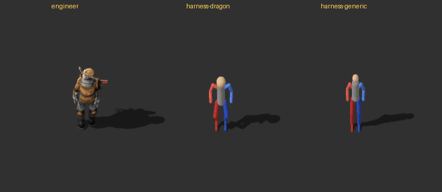 (2 frames, one every 10 ticks; [all frames](idle-south-strip.png))

- engineer: moved 0.15
- harness-dragon: moved 0.15
- harness-generic: moved 0.15

## run-east

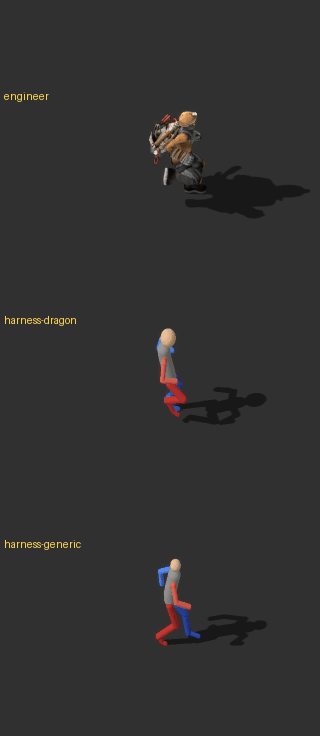 (31 frames, one every 2 ticks; [all frames](run-east-strip.png))

- engineer: moved 14.84
- harness-dragon: moved 14.84
- harness-generic: moved 14.84

## run-south

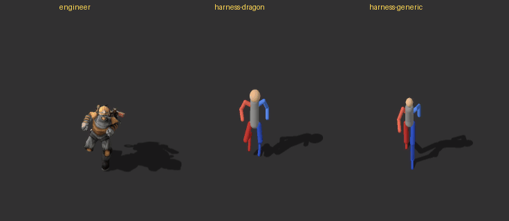 (26 frames, one every 2 ticks; [all frames](run-south-strip.png))

- engineer: moved 13.36
- harness-dragon: moved 13.36
- harness-generic: moved 13.36

## run-gun-east-aim-north

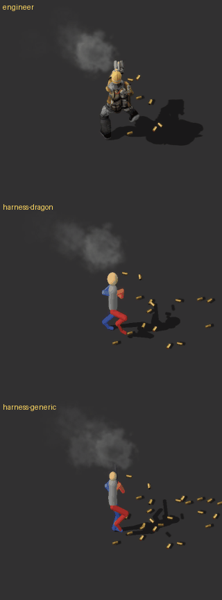 (31 frames, one every 2 ticks; [all frames](run-gun-east-aim-north-strip.png))

- engineer: moved 4.3, shots_fired 17
- harness-dragon: moved 4.3, shots_fired 17
- harness-generic: moved 4.3, shots_fired 17

## run-gun-west-aim-north

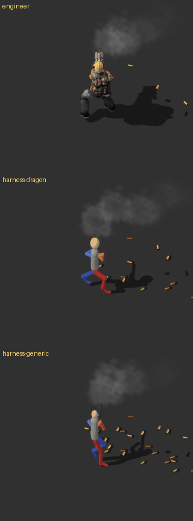 (31 frames, one every 2 ticks; [all frames](run-gun-west-aim-north-strip.png))

- engineer: moved 4.3, shots_fired 17
- harness-dragon: moved 4.3, shots_fired 17
- harness-generic: moved 4.3, shots_fired 17

## run-gun-east-aim-east

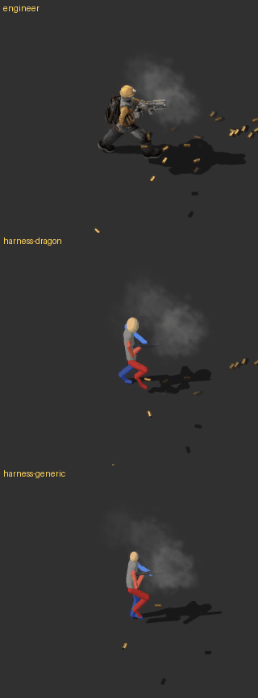 (31 frames, one every 2 ticks; [all frames](run-gun-east-aim-east-strip.png))

- engineer: moved 4.3, shots_fired 17
- harness-dragon: moved 4.3, shots_fired 17
- harness-generic: moved 4.3, shots_fired 17

## run-gun-east-aim-south

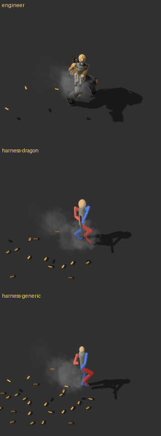 (31 frames, one every 2 ticks; [all frames](run-gun-east-aim-south-strip.png))

- engineer: moved 4.3, shots_fired 17
- harness-dragon: moved 4.3, shots_fired 17
- harness-generic: moved 4.3, shots_fired 17

## run-gun-north-aim-west

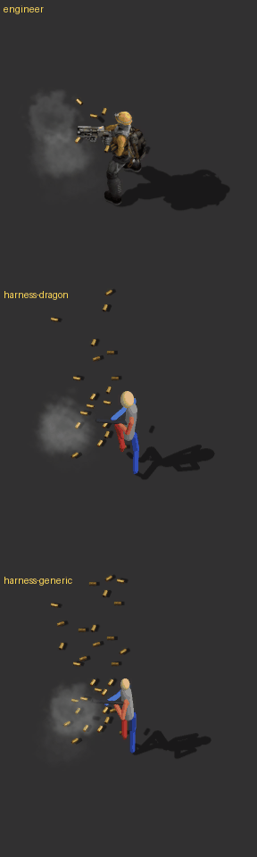 (31 frames, one every 2 ticks; [all frames](run-gun-north-aim-west-strip.png))

- engineer: moved 4.3, shots_fired 17
- harness-dragon: moved 4.3, shots_fired 17
- harness-generic: moved 4.3, shots_fired 17

## mine-east

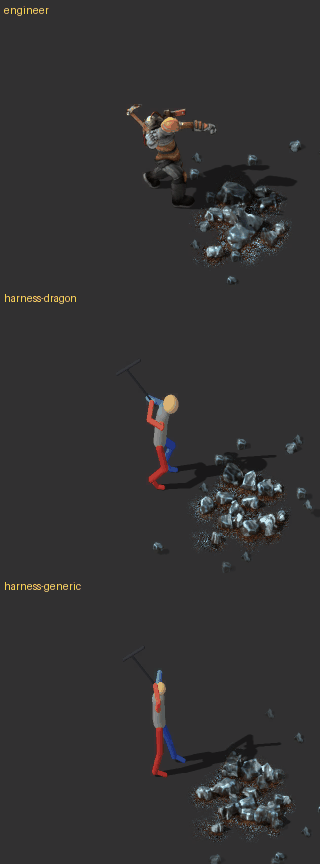 (31 frames, one every 2 ticks; [all frames](mine-east-strip.png))

- engineer: moved 0.15, ore_mined 1
- harness-dragon: moved 0.15, ore_mined 1
- harness-generic: moved 0.15, ore_mined 1

## fly-east

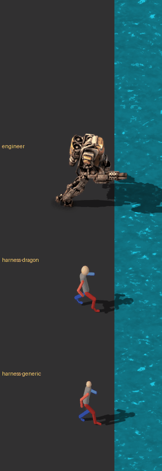 (57 frames, one every 3 ticks; [all frames](fly-east-strip.png))

- engineer: moved 19.26, flew True
- harness-dragon: moved 19.26, flew True
- harness-generic: moved 19.26, flew True

## fly-land-east

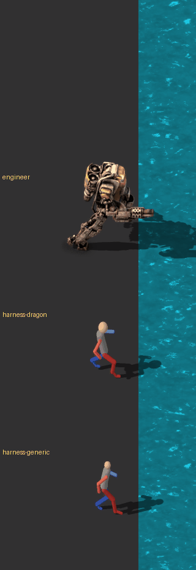 (57 frames, one every 3 ticks; [all frames](fly-land-east-strip.png))

- engineer: moved 28.13, flew True, landed True, landed_at_tick 102
- harness-dragon: moved 28.13, flew True, landed True, landed_at_tick 102
- harness-generic: moved 28.13, flew True, landed True, landed_at_tick 102

## fly-gun-east-aim-north

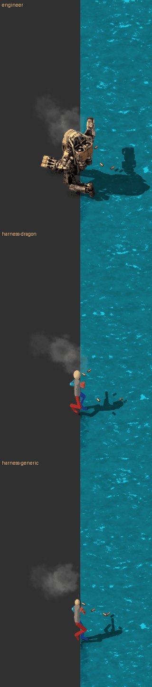 (57 frames, one every 3 ticks; [all frames](fly-gun-east-aim-north-strip.png))

- engineer: moved 6.97, shots_fired 32, flew True
- harness-dragon: moved 6.97, shots_fired 32, flew True
- harness-generic: moved 6.97, shots_fired 32, flew True

## fly-gun-east-aim-east

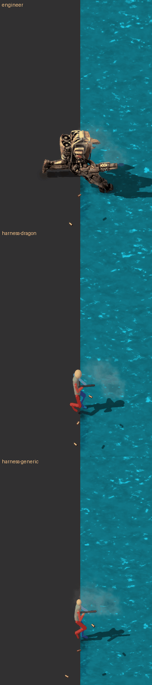 (57 frames, one every 3 ticks; [all frames](fly-gun-east-aim-east-strip.png))

- engineer: moved 6.97, shots_fired 32, flew True
- harness-dragon: moved 6.97, shots_fired 32, flew True
- harness-generic: moved 6.97, shots_fired 32, flew True

## corpse

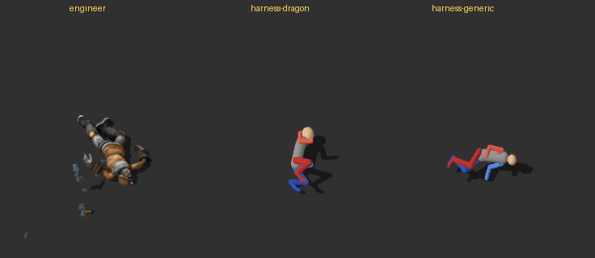 (1 frames, one every 10 ticks; [all frames](corpse-strip.png))

- engineer: corpse True
- harness-dragon: corpse True
- harness-generic: corpse True

## The avatar window

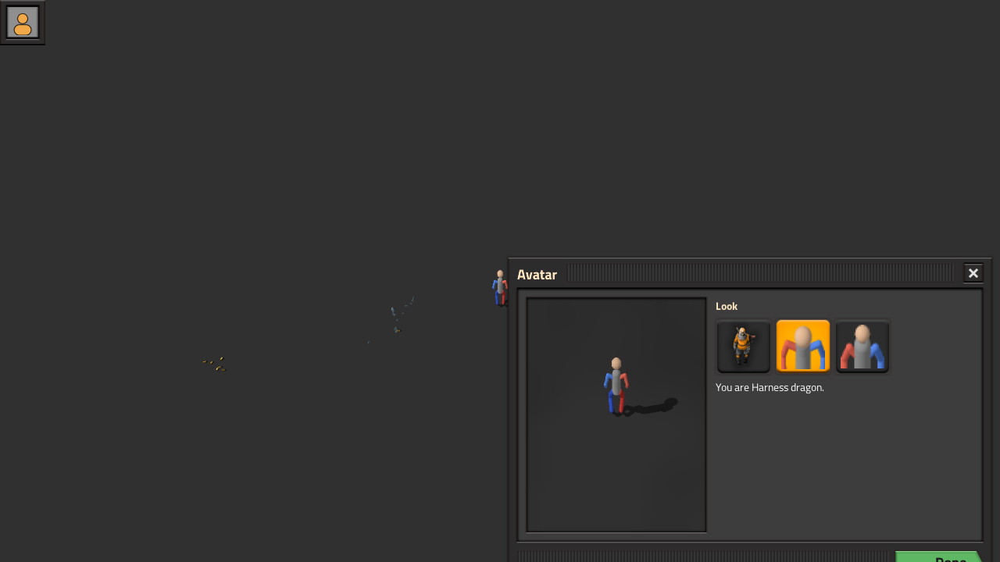

- character: avatar-pack-harness-dragon, pack: harness-dragon, status: applied, window_open: True

## Observations

### This run

- **Code:** main at `7d19093`, Factorio 2.1.23 (Steam, Space Age).
- **Mod:** Avatar Characters **0.3.1**. The release zip `avatar-characters_0.3.1.zip` was downloaded
  from the newest release (exporter-v0.5.1; the repository is now MilkJugg24/Factorio-VRChat-Avatar-Exporter).
  Its 21 files are identical to the repository's `avatar-characters` folder apart from line endings,
  and that folder is what the check script loads. The log shows `avatar-characters 0.3.1`.
- **Bundle:** "Test server", rebuilt exactly as last time: `harness-generic` (`--rig generic`, the
  humanoid exporter, the stand-in for a Unity export) and `harness-dragon` (`--rig dragon`, the
  archived dragon's `DragonPoseSource`). The generic pack changed with the exporter (2.22 → 2.29 MB);
  the dragon pack is unchanged.
- **Results:** every scene ran with no **problem** lines and no fixes. Compared below with
  `2026-10-23-1047`.
- **Frame timing:** frame n is at tick `from + every × (n − 1)`: 20 + 3(n − 1) for the flight scenes,
  100 + 2(n − 1) for mine-east. Distances are in tiles from the entity position, east positive.

### fly-gun-east-aim-north and fly-gun-east-aim-east

- **Phases:** with the lake now a tile ahead and the stop at tick 160, both scenes show
  - take-off: frames 2–12 (ticks 23–53);
  - **flight while moving with the gun: frames 13–47 (ticks 56–158), 35 of the 57 frames** (about 8
    in 2026-10-23-1047);
  - hover with the gun: frames 48–57.

  During the flight the torso aims the gun (up for north, level for east), the muzzle flash is at the
  barrel, and the legs trail back: stretched behind for generic, folded under for dragon.
- **harness-generic, aim-east:** holds the gun through take-off, level and pointing east, with every
  muzzle flash at the barrel tip (frames 2, 4, 6, 8, 10, 12). **Fixed.**
- **harness-generic, aim-north: holds the gun, but the flash is not at it.**
  - Take-off is drawn facing the way it travels, so the gun points **east** in frames 2–12. The shots
    go north, so the flash appears about 0.7 tile above the head (frames 2, 4, 6, 8, 10, 12).
  - At frame 13 the gun snaps from east to north as flight with the gun starts.
  - Factorio has one take-off animation with no aim direction, so the flash only lines up when the
    aim matches the direction of travel.
- **harness-dragon** (old dragon poses, not touched by the fix) still takes off empty-handed. Its flash
  floats about 0.7 tile from the hands: east of the body for aim-east (frames 2, 4, 6, 8, 12), above
  the head for aim-north. It only matters if `DragonPoseSource` is still offered for packs.

### mine-east: where harness-generic's pick point lands

- **Exact position:** measured from the pack's own `mine` sheet (east row; the pick is the only
  dark-grey part). In animation frames 9–11 (frame 9 is `mine_impact_frame`) the pick's lowest point is
  at **x = +0.84 to +0.86**, 0.02 below the entity position.
  - Relative to the figure: its feet bottom out at −0.14 and its front foot is at +0.09, so the point
    is **0.12 tile above the feet's ground line and about 0.75 tile ahead of the front foot**.
- **In the game:** the strike shows in **frames 5–8 (ticks 108–114)**.
  - The ore patch's near edge in this lane is at **+0.51**, measured from the screenshots, so the
    point lands **about 0.34 tile inside the ore patch**.
  - Frame 9 (tick 116) is on the way back up, matching animation frame 12, where the point is at
    +0.69, 0.11 up.
- **Before (2026-10-23-1047):** the head stopped at about +0.45 and 0.25 tile above the ground, short of
  that lane's ore edge (+0.48).
- **Engineer:** his pick comes down in frames 6–7 (ticks 110–112). The handle reaches the ground at
  about **+1.45 to +1.5**, near the middle of the patch, about a tile past its near edge (+0.51 in his
  lane). Frames 5 and 8 show it on the way down and back up.
- **Swing rate:** unchanged, the same for all three.
- **Remaining gap:** generic now hits the ore, but about 0.6 tile closer to its feet than the engineer.
  Its pick still jumps from overhead (animation frame 8) straight to the ground (frame 9), with nothing
  in between (game frames 4 → 5). That was already the case before.

### window/window.png: centred? Done visible?

- **In the screenshot: no.** The window sits at the same place as before, top-left corner at
  (650, 330), and the green Done button is cut off at the bottom edge of the 1280×720 image.
- **In the game: yes, centred.** A probe mod opened the window the same way and logged its location
  each tick.
  - It is at (0, 0) in the tick it opens and at **(650, 330) from the next tick on**, unchanged up to
    70 ticks later.
  - The game reports the player's screen as **1920×1080**. A window of about 620×410 centred on
    1920×1080 has its top-left at (650, 335), and its Done button ends around y = 740, well on screen.
- **So 0.3.1 centres the window.** The check's screenshot is taken at 1280×720, smaller than the
  player's screen, and crops the GUI. For a faithful shot, use `resolution = player.display_resolution`
  in the test's `window_shot`, or run the game windowed at 1280×720.
- **Content:** unchanged. The engineer, Harness dragon (selected) and Harness generic are listed, it
  says "You are Harness dragon.", and the preview shows the figure.

### Newly broken compared with 2026-10-23-1047

- **Unarmed characters now show a gun at take-off and landing.** In fly-east and fly-land-east nobody
  carries a gun, yet harness-generic now holds one:
  - while taking off: frames 4–13, ticks 29–56;
  - while landing, the reversed take-off: fly-land-east frames 20–27, ticks 77–98.

  It flies without it in between. Before, its hands were empty throughout.
  - This is the price of "take-off holds the gun": Factorio has a single take-off animation for armed
    and unarmed characters. It trades the floating flash when armed for a phantom gun when unarmed.
  - A player without a gun, or between gun slots, will see it appear on every take-off and landing.
- **Everything else unchanged:**
  - idle-south, run-east and run-south are practically identical in every lane (mean pixel
    difference below 0.01 per channel);
  - the five on-foot gun scenes show the same poses for all three; only the random shell casings and
    smoke differ;
  - fly-east and fly-land-east differ for the engineer and harness-dragon only by splash particles;
  - corpses: harness-dragon and harness-generic are identical; the engineer's vanilla corpse varies;
  - harness-dragon is unchanged in every scene.
- **mine-east:** generic's new swing crouches lower and reaches out. No frame of it goes into the
  ground.
