# In-game checks

Mods: avatar-bundle-test-server 1.0.1, avatar-characters 0.3.1, avatar-characters-screenshots 0.1.0, base 2.1.23, elevated-rails 2.1.23, quality 2.1.23, recycler 2.1.23, space-age 2.1.23

## idle-south

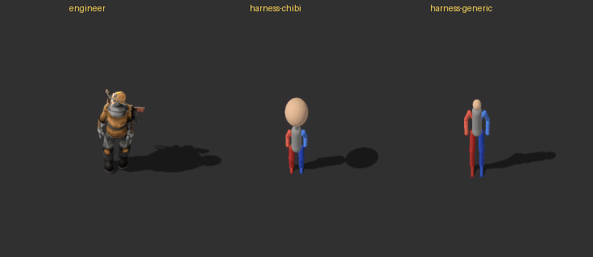 (2 frames, one every 10 ticks; [all frames](idle-south-strip.png))

- engineer: moved 0.15
- harness-chibi: moved 0.15
- harness-generic: moved 0.15

## run-east

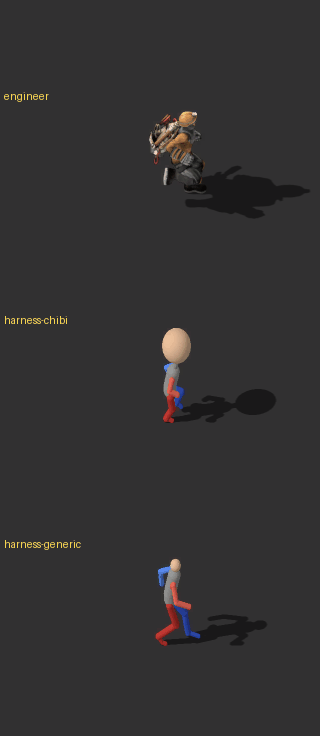 (31 frames, one every 2 ticks; [all frames](run-east-strip.png))

- engineer: moved 14.84
- harness-chibi: moved 14.84
- harness-generic: moved 14.84

## run-south

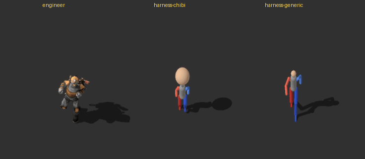 (26 frames, one every 2 ticks; [all frames](run-south-strip.png))

- engineer: moved 13.36
- harness-chibi: moved 13.36
- harness-generic: moved 13.36

## run-gun-east-aim-north

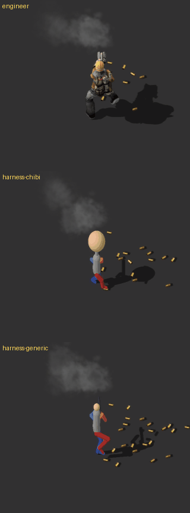 (31 frames, one every 2 ticks; [all frames](run-gun-east-aim-north-strip.png))

- engineer: moved 4.3, shots_fired 17
- harness-chibi: moved 4.3, shots_fired 17
- harness-generic: moved 4.3, shots_fired 17

## run-gun-west-aim-north

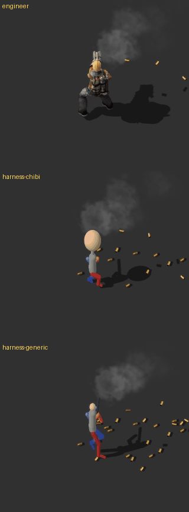 (31 frames, one every 2 ticks; [all frames](run-gun-west-aim-north-strip.png))

- engineer: moved 4.3, shots_fired 17
- harness-chibi: moved 4.3, shots_fired 17
- harness-generic: moved 4.3, shots_fired 17

## run-gun-east-aim-east

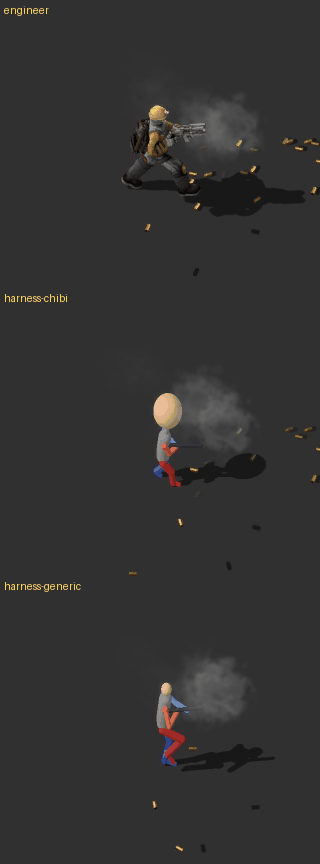 (31 frames, one every 2 ticks; [all frames](run-gun-east-aim-east-strip.png))

- engineer: moved 4.3, shots_fired 17
- harness-chibi: moved 4.3, shots_fired 17
- harness-generic: moved 4.3, shots_fired 17

## run-gun-east-aim-south

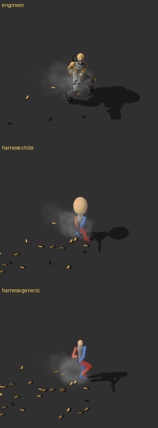 (31 frames, one every 2 ticks; [all frames](run-gun-east-aim-south-strip.png))

- engineer: moved 4.3, shots_fired 17
- harness-chibi: moved 4.3, shots_fired 17
- harness-generic: moved 4.3, shots_fired 17

## run-gun-north-aim-west

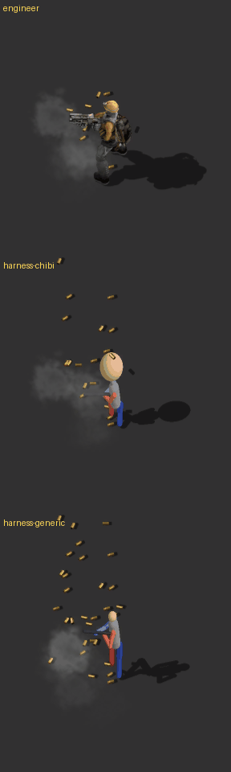 (31 frames, one every 2 ticks; [all frames](run-gun-north-aim-west-strip.png))

- engineer: moved 4.3, shots_fired 17
- harness-chibi: moved 4.3, shots_fired 17
- harness-generic: moved 4.3, shots_fired 17

## mine-east

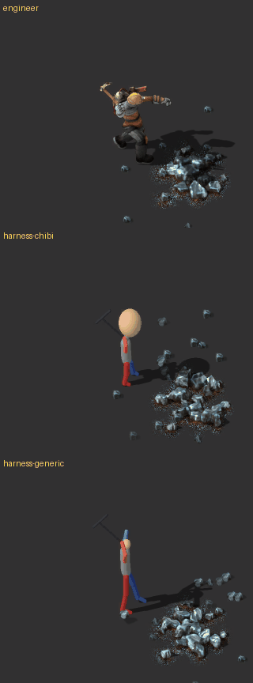 (31 frames, one every 2 ticks; [all frames](mine-east-strip.png))

- engineer: moved 0.15, ore_mined 1
- harness-chibi: moved 0.15, ore_mined 1
- harness-generic: moved 0.15, ore_mined 1

## fly-east

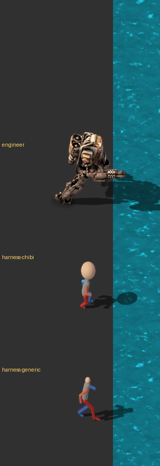 (57 frames, one every 3 ticks; [all frames](fly-east-strip.png))

- engineer: moved 19.26, flew True
- harness-chibi: moved 19.26, flew True
- harness-generic: moved 19.26, flew True

## fly-land-east

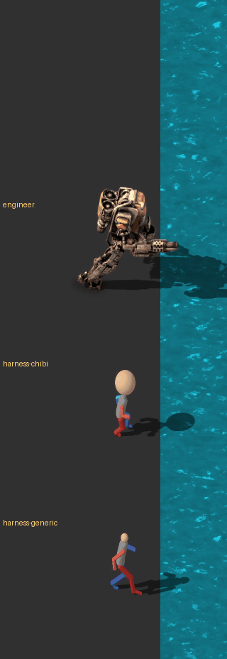 (57 frames, one every 3 ticks; [all frames](fly-land-east-strip.png))

- engineer: moved 28.13, flew True, landed True, landed_at_tick 102
- harness-chibi: moved 28.13, flew True, landed True, landed_at_tick 102
- harness-generic: moved 28.13, flew True, landed True, landed_at_tick 102

## fly-gun-east-aim-north

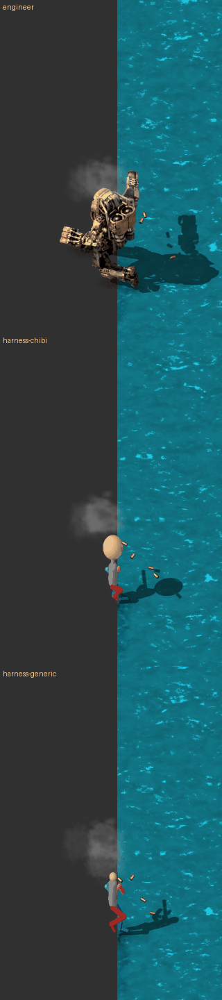 (57 frames, one every 3 ticks; [all frames](fly-gun-east-aim-north-strip.png))

- engineer: moved 6.97, shots_fired 32, flew True
- harness-chibi: moved 6.97, shots_fired 32, flew True
- harness-generic: moved 6.97, shots_fired 32, flew True

## fly-gun-east-aim-east

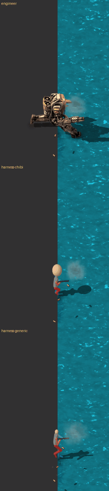 (57 frames, one every 3 ticks; [all frames](fly-gun-east-aim-east-strip.png))

- engineer: moved 6.97, shots_fired 32, flew True
- harness-chibi: moved 6.97, shots_fired 32, flew True
- harness-generic: moved 6.97, shots_fired 32, flew True

## corpse

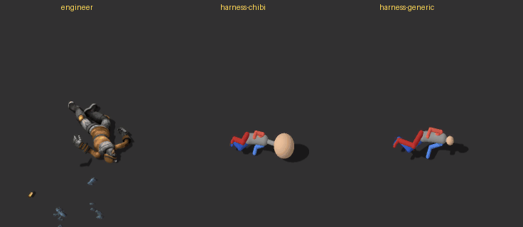 (1 frames, one every 10 ticks; [all frames](corpse-strip.png))

- engineer: corpse True
- harness-chibi: corpse True
- harness-generic: corpse True

## The avatar window

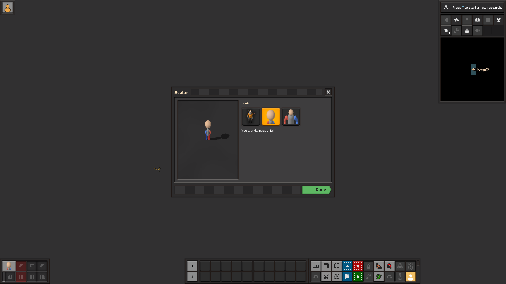

- character: avatar-pack-harness-chibi, pack: harness-chibi, status: applied, window_open: True

## Observations

### This run

- **Code:** main at `1a91f37`, Factorio 2.1.23 (Steam) with Space Age, Avatar Characters 0.3.1 (log line 42).
- **Bundle:** "Test server" **1.0.1** built from two humanoid harness packs, `harness-generic`
  (`--rig generic`) and `harness-chibi` (`--rig chibi`). Lanes run engineer, harness-chibi, harness-generic.
- **Results:** every scene ran with no **problem** lines and no fixes.
- **Frame timing:** frame n is at tick `from + every × (n − 1)`: 40 + 2(n − 1) for idle, run and the
  gun scenes on foot, 100 + 2(n − 1) for mine-east, 20 + 3(n − 1) for the flight scenes. Positions
  are in tiles from the entity position, east positive.

### a. window/window.png

**Centred, with Done visible.** The shot is now taken at the player's screen size (1920×1080). The
Avatar window spans (650, 330)–(1270, 750), centred on the screen, with the green **Done** button at the
bottom right. It lists the engineer, Harness chibi (selected) and Harness generic, and says "You are
Harness chibi.".

### b. mine-east

- **No more jump from overhead to the ground.** The downswing now spans three animation frames for
  both figures. In the east-facing `mine` sheets: frame 7 overhead, **frame 8 mid-swing** (pick angled
  forward, head about a tile ahead and a tile up), frame 9 on the ground. Frames 9–11 hold the strike;
  frame 12 starts the lift.
- **In the game, generic and chibi:**
  - frames 1–3 (ticks 100–104): pick overhead;
  - **frame 4 (tick 106): mid-swing**;
  - frames 5–9 (ticks 108–116): pick on the ground;
  - frames 10–12: lifting.

  In 2026-10-23-1153 frame 4 still showed the pick overhead.
- **Engineer:** raised in frames 1–4, coming down in frame 5, on the ground in frames 6–7 (ticks
  110–112), lifting from frame 8.
- **Where the pick point lands:** the lowest pick pixel in strike frames 9–11, read from each pack's
  sheet. The ore's near edge in each lane is read from the screenshots.

  | | Point x | Above the feet's ground line | Ahead of the front foot | Ore's near edge | Point inside the ore |
  | --- | --- | --- | --- | --- | --- |
  | harness-generic | +0.84 to +0.86 | 0.12 | 0.75 | +0.47 | about 0.38 |
  | harness-chibi | +0.88 to +0.89 | 0.10 | 0.82 | +0.51 | about 0.38 |
  | engineer | about +1.45 to +1.5 (handle tip, frames 6–7) | at the ground | – | +0.48 | about 1.0 |

  Both figures now hit the ore, about 0.6 tile closer to their feet than the engineer. Every figure
  mines one ore.

### c. harness-chibi in every scene

- **Size:**
  - The head top is 87 px above the feet, against 97 px for the engineer: about 90% of his height,
    much of it the big head.
  - The body is shorter, so the gun and pick are held near the head.
- **Feet on the ground:**
  - At idle the lowest pixel is 9 px below the entity position (engineer 7 px).
  - The feet stay on the ground line while running: run-east 1–6 px below, run-south 17–27 px with
    the stride toward the camera.
- **Shadow:**
  - Cast east and slightly up, like the engineer's: centroid (+38, −9.5) px at idle against (+52, −11).
    So it's shorter.
  - It starts about 5 px above the leg ends, as with generic.
  - In run-south it swings with the stride (centroid +17 to +56), smoothly.
- **Leg pace:**
  - Runs with real strides at a **22-tick cycle** (engineer 32, generic 38).
  - That is intended: its `distance_per_frame` is 0.159 because the exporter scales the stride to its
    short legs. Quick little steps; no sliding visible.
- **Gun in both hands:**
  - aim east: level, the near (red) hand on the grip and the far (blue) arm on the gun;
  - aim south: pointing down toward the camera, in front of the body;
  - aim west: mirrored, pointing west, held by both hands; the shadow still falls east.
  - Aiming north (run-gun-east/west-aim-north, frame 10) the gun is hidden behind the big head and
    only the hands at the chest show.
  - 17 shots in every on-foot gun scene, 32 in the fly-gun scenes.
- **Take-off with the gun:**
  - fly-gun-east-aim-east: holds the gun level with the flash at the muzzle (seen in frames 6 and 8).
  - **fly-gun-east-aim-north: the gun points east, the way it's travelling, while the shots go north.**
    The flash floats about 0.7 tile above the head (frame 6). It snaps north at frame 13. Same as
    generic in 2026-10-23-1153, not new.
- **Unarmed take-off and landing:** in fly-land-east (no gun given) it shows a gun while landing, e.g.
  frame 24, as generic did in 2026-10-23-1153. Not new: this is the single take-off animation holding
  the gun.
- **Flight:** takes off, flies with the legs trailing (fly-gun frame 25), hovers upright after the
  stop (frame 52), and lands across the narrow lake at tick 102 like everyone else.
- **Corpse:** lies flat on its side, head east, shadow attached.

### d. Newly broken compared with 2026-10-23-1153

Nothing.

- idle-south, run-east, run-south, fly-land-east and corpse are unchanged for the engineer and
  generic: mean pixel difference below 0.01 per channel.
- In the gun, mining and fly-gun scenes the only differences are the random shell casings, smoke,
  muzzle flash and ore sprite. Generic's poses are identical.
- The engineer's fly-east and fly-land-east lane differs only where the neighbouring lane (chibi now,
  dragon before) flies up into it.
- The one pose change is the intended mid-swing in mine-east frame 4.
- **Still open, both from 0.3.1:**
  - the gun shown on unarmed characters at take-off and landing;
  - the aim-north take-off pointing the gun east.

## Multiplayer

Screenshots, logs and the scripts used are in [multiplayer/](multiplayer/).

### Setup

- **Folders:** everything ran under `%TEMP%\avatar-mp`; no personal saves or mods were touched. The
  server, the client and a second client each had their own `config.ini`, `write-data` folder and mods
  folder.
- **Mods** on the server and the client: `avatar-characters_0.3.1.zip`, zipped from the repo's
  `avatar-characters` folder, and `avatar-bundle-test-server_1.0.1.zip`. Space Age, Quality and
  Elevated Rails were on.
- **Save and server:** a new game was made with `--create` and served with `--start-server`.
  `server-settings.json` sets no public or LAN listing and no user verification. RCON was on port
  27015.
- **Client:** joined with `--mp-connect localhost:34197`, as **MilkJugg24** (the Steam name), on a
  1920×1080 screen.
- **How it was driven:**
  - No desktop control was available in this session, so the client's GUI was not clicked.
    Ctrl + Shift + A was not pressed; the window was opened with the mod's remote interface
    (`open_window`), and the looks were picked with `set_appearance`, which applies them through the
    same function the window's buttons call.
  - Everything was sent from the server console over RCON (`multiplayer/scripts`).
  - Running, shooting and mining had to be re-applied every tick by a temporary console
    `script.on_nth_tick` handler. A one-off `walking_state` / `shooting_state` / `mining_state` on a
    connected player is undone by the client's own input within a tick or two: 0.89 tiles walked,
    one pistol shot, nothing mined. The handler was removed before every reconnect, because console
    handlers aren't saved.
- **Screenshots:**
  - Taken on the client with `game.take_screenshot{by_player = ...}`.
  - In multiplayer the player's own character is left out of script screenshots unless they include
    the GUI (`show_gui = true`). This held for the engineer too
    (`40-engineer-at-position.png`, `40-chibi-at-position.png`), so it isn't the mod.
  - The gameplay shots therefore include the HUD.

### Results

1. **Look changes:** generic → chibi → engineer → chibi all applied immediately, and the character
   entity followed: `character` → `avatar-pack-harness-generic` → `avatar-pack-harness-chibi` →
   `character` → `avatar-pack-harness-chibi`.
   - The client's window shots (`01`–`05-window-*.png`) show the window centred on its 1920×1080
     screen, with the right look selected and "You are …" updated each time.
   - The freeplay pistol and ammo carried over through every swap.
2. **Playing as Harness chibi** (`50`–`55-*.png`), given an SMG with 20 magazines and mech armor:
   - ran 17.8 tiles in 2 s;
   - ran while shooting at a target 12 tiles north: 20 rounds from the SMG, 5.2 tiles at the
     gun's 30% speed;
   - mined an ore;
   - with mech armor: took off over an 8-tile lake, flew across and landed (22.2 tiles).

   The screenshots show chibi running, shooting with casings and smoke, mining with particles,
   taking off over water with the gun and its shadow below, flying, and standing after landing.
   The character stayed `avatar-pack-harness-chibi` throughout.
3. **`/c game.print(game.players[1].character.name)` on the server console:** it ran
   (`server-console.log`: `[COMMAND] <server> (command): game.print(game.players[1].character.name)`).
   - Its text goes to the in-game chat, which neither the console log nor script screenshots
     capture.
   - The same expression over RCON, `rcon.print(game.players[1].character.name)`, returned
     **`avatar-pack-harness-chibi`**.
4. **Disconnect and reconnect:** the client was closed (the process ended; no GUI to click
   Disconnect) and started again.
   - While away, the server showed MilkJugg24 offline with no character and the chibi choice kept.
   - After rejoining: still **Harness chibi with the same items**: 4 iron ore, 37 iron plate, burner
     mining drill, stone furnace, wood, pistol, SMG, 44 magazines, mech armor. Same position
     (75.7, 0); `61-after-reconnect.png`.
5. **Server save and restart:** `/server-save`, then `/quit` (clean), then a restart from the save,
   then a reconnect. Again Harness chibi with exactly the same items and position
   (`62-after-server-restart.png`).
6. **Mismatch (client bundle 1.0.2, server 1.0.1):**
   - Server log: `Refusing connection for address (IP ADDR:({127.0.0.1:64175})), username (MilkJugg24). ModsMismatch`.
   - Client log: `Connection refused`.
   - The client shows a **Confirmation** dialog: "Your active mods don't match the server's. Do you
     want to sync your mods with the server?", with **Back** and **Synchronize**
     (`70-mismatch-dialog.png`; behind it, the "Updated to version 2.1.23" changelog that a fresh
     profile shows).
   - Synchronize was not tried: it downloads from the mod portal, where the bundle isn't published.
7. **A second player:** not possible on this PC. A second client with its own profile (and
   `player-data.json` asking for the username `Tester2`) still joined under the Steam account's name.
   The server refused it: `Refusing connection for address (IP ADDR:({127.0.0.1:50471})), username (MilkJugg24). UserWithThatNameAlreadyInGame`.
   It needs a second Steam or Factorio account.
8. **Logs:** in every server and client log (`multiplayer/logs`) there is **no "desync" and no
   "error"**.
   - "avatar-characters" appears only in the loading lines, with the same checksums everywhere: data
     `2360450080`, `control.lua` `199544188`.
   - The client log of the first session, with the looks and the play test, was rotated away by
     restarts. The server log of that session (`server-run1.log`) covers it and is clean.
